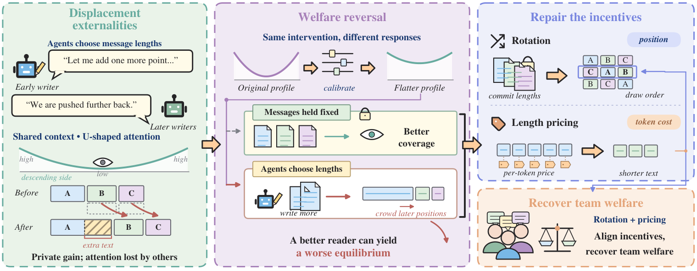
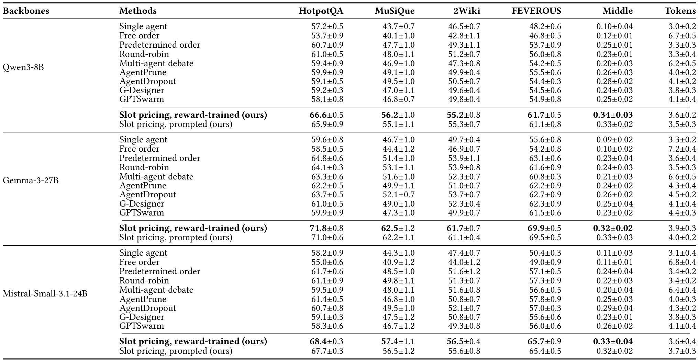
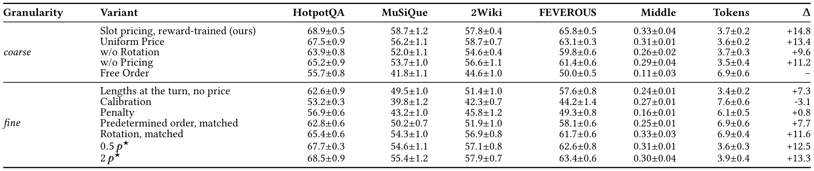
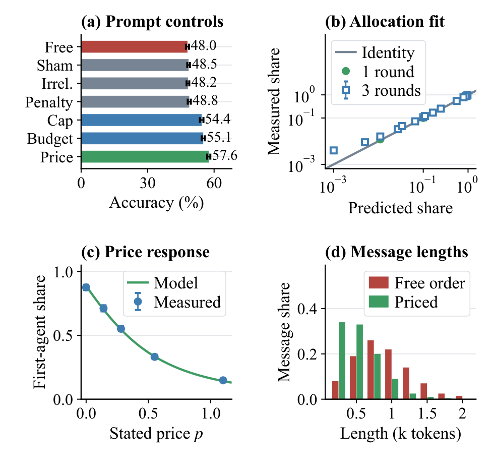

# Displacement Externalities in Endogenous Position Games for Multi-Agent LLM Communication

Multi-agent LLM systems use shared transcripts to coordinate reasoning, yet
message lengths determine both communication cost and the context available to
later agents. Early writers can therefore benefit from additional text while
reducing the value of downstream communication. To study this interaction, we
formulate an endogenous position game with position-dependent attention and
token costs. We derive its unique subgame-perfect equilibrium in closed form and
show that message lengths decay geometrically across speaking positions. The
resulting displacement externality reduces team welfare, with inefficiency
growing as the team expands. The analysis also predicts a calibration reversal
in which flatter attention improves coverage of a given transcript but reduces
equilibrium efficiency as writers adapt. To address these incentives, we study
drawn-order rotation and token pricing, and derive a continuation-value toll
that implements the planner allocation. Under linear attention, this toll
reduces to a slot-dependent price. A policy trained with this price reaches
96.2% of planner welfare. Across three LLM families and four reasoning
benchmarks, slot pricing improves average accuracy by 14.8 points over
free-order communication while reducing generated tokens by 46.4%. It also
exceeds the strongest baseline within 0.4k tokens of its budget by 7.1 points.

## Algorithm Flow

To connect positional attention with communication incentives, we first derive the best response and equilibrium allocation. We then quantify the displacement externality and welfare loss. Finally, we derive rotation and pricing mechanisms that change positional and marginal incentives.



**Figure 1.** Endogenous position formation, calibration reversal, and incentive design. Longer early messages shift downstream communication toward weaker positions. Drawn-order rotation and length pricing act on the corresponding positional and marginal incentives.

**Training and deployment.** To learn the price response, a tabular policy maps remaining capacity and slot index to a distribution over feasible lengths on a 201-point grid. We train it for 4000 updates using groups of 32 trajectories and policy gradients with each agent’s group-mean reward as a baseline. The reward is its payoff under the slot price, while reported welfare uses the true token cost. At deployment, policy outputs set per-slot token caps before parallel drafting. The prompted variant communicates the same price through a sentence in the prompt. Both variants use the released language-model weights.

## Results

### Main Results

**Table 1.** Main results on four benchmarks, grouped by backbone. Values are five-seed means with standard deviations. Middle is the mean attention share on the middle third of the transcript. Tokens reports thousands of generated tokens per team, or per agent for single-agent inference. The two proposed variants use the same slot-price schedule through a trained policy or a prompted price signal.



### Ablation Study

**Table 2.** Coarse and fine ablations with three agents, averaged over three backbones and five seeds. Deviations are standard deviations across seeds. Matched variants use the 6.9k-token free-order budget; price multipliers scale the theory-guided uniform price. Δ is the accuracy gain over free order. Middle and Tokens follow Table 1.



**The per-slot cap encodes the planner allocation, while the uniform cap equalizes lengths.** The trained policy adapts its allocation to residual capacity. Increasing the generation budget to 6.9k changes predetermined-order accuracy from 55.3 to 55.8 and rotation from 59.2 to 59.6, hence the larger gains come from reallocating shared context.

### Analysis



**Figure 2.** Mechanism controls. (a) Accuracy under prompt controls and pricing on a predetermined order. (b) Predicted and measured capacity shares. (c) First-agent share as the stated price increases. (d) Message-length distributions. Error bars in (a)–(c) show five-seed standard deviations.

**Increasing price reduces the first-agent share from 0.876 to 0.148 (Figure 2c) and shifts the distribution toward shorter messages (Figure 2d).** These responses follow from the reduced marginal value of occupying context.

## Getting Started

### Environment Setup

```bash
conda create -n deepg python=3.10 -y
conda activate deepg
pip install -e '.[local,data]'
```

### Data Preparation

Download [HotpotQA](https://hotpotqa.github.io/),
[MuSiQue](https://github.com/StonyBrookNLP/musique),
[2WikiMultihopQA](https://github.com/Alab-NII/2wikimultihop), and
[FEVEROUS](https://fever.ai/dataset/feverous.html).
Set the dataset paths in `configs/paper.yaml` and save retrieved FEVEROUS evidence
to `data/feverous/evidence.json`. The loaders accept the benchmark formats described
in [data inputs](docs/data.md). Prepare the upstream baselines as described in
[baseline execution](docs/protocols.md).

## Training

Train the length policies:

```bash
python -m deepg train --schedule unpriced uniform slot \
  --output checkpoints
```

## Evaluation

Run the evaluation matrix and aggregate the outputs:

```bash
python scripts/run_matrix.py --config configs/paper.yaml --policy checkpoints \
  --evidence data/feverous/evidence.json --execute --output results/main

python -m deepg summarize results/main/*/*/*.jsonl \
  --output results/summary.csv
```

## License

The code uses the [MIT License](LICENSE).
