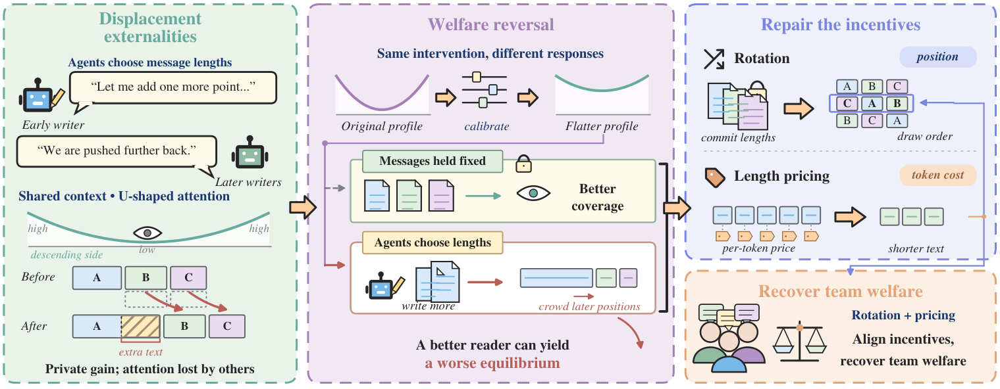

# Displacement Externalities in Endogenous Position Games for Multi-Agent LLM Communication

Open-source code for the paper.

Multi-agent LLM systems use shared transcripts to coordinate reasoning, yet message lengths determine both communication cost and the context available to later agents. Early writers can therefore benefit from additional text while reducing the value of downstream communication.



Endogenous position formation, calibration reversal, and incentive design. Longer early messages shift downstream communication toward weaker positions. Drawn-order rotation and length pricing act on the corresponding positional and marginal incentives.

## Installation

Python 3.10 or later.

```bash
python3.10 -m venv .venv
source .venv/bin/activate
pip install -e ".[local,data,test]"
```

## Usage

Train the slot-priced length policy, then evaluate prepared benchmark records.

```bash
deepg train --schedule slot --output checkpoints
deepg evaluate --model Qwen3-8B --dataset hotpotqa --method slot_trained \
  --data data/hotpotqa/dev_distractor.jsonl --policy checkpoints \
  --output results/qwen_hotpot_slot.jsonl
```

[Input formats](docs/data.md) describe benchmark preparation. Settings and ablation controls are in [configs](configs). Use `deepg --help` for the available commands.

## Software checks

```bash
pytest -q -p no:cacheprovider
```

The code uses the [MIT License](LICENSE). The paper image retains its published license.
